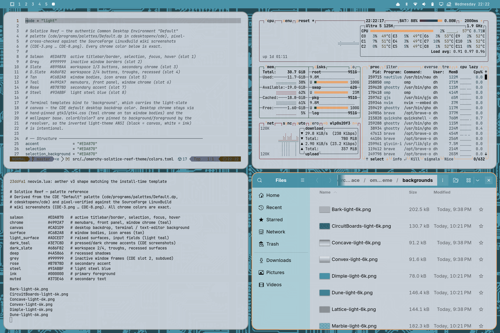

# Solstice — Reef

An Omarchy theme built on the **original CDE "Default" palette**
(`Default.dp`): teal chrome like reef water, salmon active borders and
selection like coral, tan window bodies, and a light-slate canvas.

Every core color is slot-exact from the palette file every CDE workstation
shipped with, pixel-verified against the
[LinuxBuild wiki screenshots](https://sourceforge.net/p/cdesktopenv/wiki/LinuxBuild/).
See [Solstice Daylight](https://github.com/circumspace/omarchy-solstice-daylight-theme)
(Solaris 9 capture), [Solstice Nightwatch](https://github.com/circumspace/omarchy-solstice-nightwatch-theme)
(NsCDE dark companion), and [Solstice Crimson](https://github.com/circumspace/omarchy-solstice-crimson-theme)
(Crimson4) for the other palettes in the family.

## Preview



## Install

```bash
omarchy theme install https://github.com/circumspace/omarchy-solstice-reef-theme
```

Then select **Solstice Reef** from the Omarchy theme picker.

Or manually:

```bash
git clone https://github.com/circumspace/omarchy-solstice-reef-theme \
  ~/.config/omarchy/themes/solstice-reef
```

## Palette

| Role | Hex | Source |
|------|-----|--------|
| Salmon (selection, active border) | `#EDA870` | `Default.dp` slot 1, exact |
| Grey (inactive border) | `#999999` | `Default.dp` slot 2, exact |
| Slate (workspace 1/3) | `#8998AA` | `Default.dp` slot 3, exact |
| Dark slate (workspace 2/4, troughs) | `#686F82` | `Default.dp` slot 4, exact |
| Tan (window bodies) | `#C6B2A8` | `Default.dp` slot 5, exact |
| Teal (chrome, menubars, front panel) | `#4992A7` | `Default.dp` slot 6, exact |
| Rose (secondary accent) | `#B7878D` | `Default.dp` slot 7, exact |
| Steel (light steel blue) | `#93ABBF` | `Default.dp` slot 8, exact |
| Canvas (terminal, content) | `#CAD1D9` | CDE default backdrop |

Full provenance in [`palette.txt`](palette.txt).

## What's themed

- **Hyprland** — bright salmon active border (`#EDA870`) over the CDE slot-2
  grey inactive frame (`#999999`) — vivid warm vs subdued neutral, so focus
  is always obvious.
- **GTK 3 / GTK 4** — teal chrome over tan window bodies, light-slate content,
  salmon selection; sharp CDE corners (`border-radius: 0`). GTK loads user CSS
  once at startup, so **restart** GTK apps after switching *into or out of*
  this theme for colors to take.
- **Terminal** — Ghostty / Alacritty / Kitty / foot palettes generated from
  `colors.toml`; terminals sit on the light-slate canvas with ANSI colors
  calibrated to ~7:1 (normals) and ~9:1 (brights).
- **Browser chrome** — `chromium.theme` sets the frame tint; apply with
  `omarchy theme set browser` (the policy write needs sudo). For full
  toolbar/tab colors, enable **Use GTK** in the browser's appearance settings —
  Chromium picks up this theme's GTK CSS.
- **Neovim** — self-contained `neovim.lua` colorscheme (no plugin dependency).
- **btop, Zed/VS Code, Helix** — generated from `colors.toml`.

## Wallpapers

Fourteen procedurally-generated backdrops in `backgrounds/` (6K), rendered at
an 8× tile scale from [NsCDE](https://github.com/NsCDE/NsCDE) XPM patterns
with the Motif colorset derived from this palette's chrome (`bg #4992A7`,
`ts #ADCED8`, `bs #244953`, `sel #3E7C8D`): **Solyaris, Dimple, Dune, Swirl,
Squares, Marble, Toronto, SandLight, CircuitBoards, Lattice, Concave, Convex,
PinStripe, Bark**. Regenerate them with
[circumspace/scripts `gen-cde-wallpapers`](https://github.com/circumspace/scripts).

## License

MIT — see [LICENSE](LICENSE).
