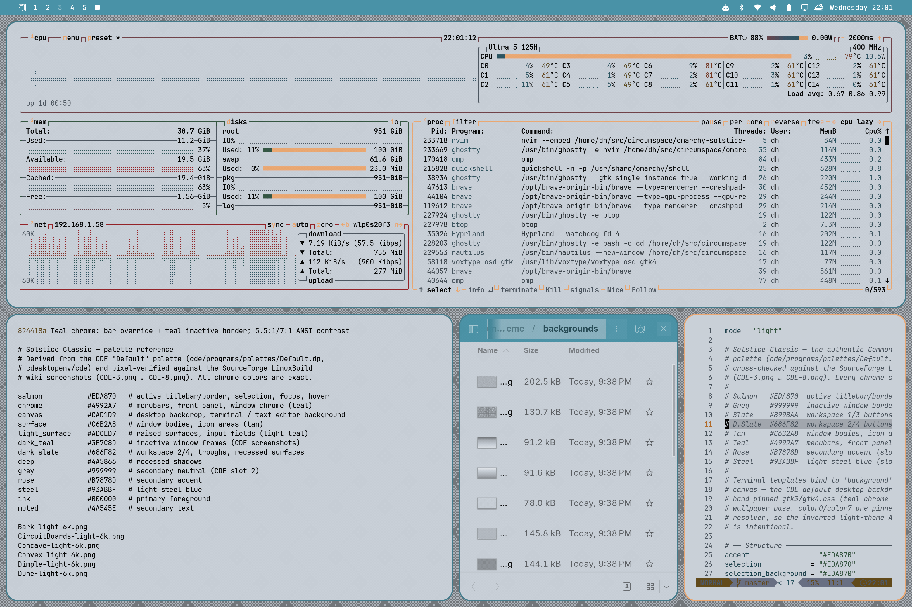

# Solstice — Classic

The **authentic Common Desktop Environment "Default" palette** as an Omarchy
theme: teal chrome, salmon active borders, tan window bodies and a light-slate
canvas — the look every CDE workstation shipped with. Every chrome color is
taken slot-exact from CDE's own `Default.dp` palette file and pixel-verified
against the [LinuxBuild wiki screenshots](https://sourceforge.net/p/cdesktopenv/wiki/LinuxBuild/).

Third member of the Solstice family alongside
[Daylight](https://github.com/circumspace/omarchy-solstice-daylight-theme) and
[Nightwatch](https://github.com/circumspace/omarchy-solstice-nightwatch-theme).

## Preview



## Install

```bash
omarchy theme install https://github.com/circumspace/omarchy-solstice-classic-theme
```

Then select **Solstice Classic** from the Omarchy theme picker.

Or manually:

```bash
git clone https://github.com/circumspace/omarchy-solstice-classic-theme \
  ~/.config/omarchy/themes/solstice-classic
```

## Palette

| Role | Hex |
|------|-----|
| Salmon (active border, selection) | `#EDA870` |
| Teal (chrome, menubars, front panel) | `#4992A7` |
| Slate canvas (desktop, terminal) | `#CAD1D9` |
| Tan (window bodies) | `#C6B2A8` |
| Light teal (raised surfaces) | `#ADCED7` |
| Dark teal (inactive border) | `#3E7C8D` |
| Rose (secondary accent) | `#B7878D` |
| Ink (foreground) | `#000000` |

The first six map 1:1 to CDE `Default.dp` slots 1, 6, 5 and the derived
backdrop/input shades. Full 16-color ANSI palette in [`palette.txt`](palette.txt).

## What's themed

- **Hyprland** — bright salmon active border (`#EDA870`, CDE slot-exact) over
  a dark-teal inactive frame (`#3E7C8D`) — warm-vs-dark so focus is never
  ambiguous.
- **GTK 3 / GTK 4** — teal chrome over tan window bodies, light-slate content,
  salmon selection; sharp CDE corners. GTK loads user CSS once at startup, so
  **restart** GTK apps after switching *into or out of* this theme for colors
  to take.
- **Terminal** — Ghostty / Alacritty / Kitty / foot palettes from `colors.toml`
  on the light-slate canvas.
- **Browser chrome** — `chromium.theme` sets the frame tint; apply with
  `omarchy theme set browser` (the policy write needs sudo). For full
  toolbar/tab colors, enable **Use GTK** in the browser's appearance settings —
  Chromium picks up this theme's GTK CSS.
- **Neovim** — self-contained `neovim.lua` colorscheme (no plugin dependency).
- **btop, Zed/VS Code, Helix** — generated from `colors.toml`.

## Wallpapers

Fourteen procedurally-generated backdrops in `backgrounds/` (6K), rendered at
an 8× tile scale from [NsCDE](https://github.com/NsCDE/NsCDE) XPM patterns,
recolored to the light-slate canvas — the CDE default desktop backdrop under
teal chrome. Regenerate them with
[circumspace/scripts `gen-cde-wallpapers --base canvas`](https://github.com/circumspace/scripts).

## Provenance & credits

- Palette source: [`Default.dp`](https://github.com/cdesktopenv/cde/blob/master/cde/programs/palettes/Default.dp)
  from [cdesktopenv/cde](https://github.com/cdesktopenv/cde).
- Verification screenshots: the
  [CDE LinuxBuild wiki](https://sourceforge.net/p/cdesktopenv/wiki/LinuxBuild/)
  captures (CDE-3 … CDE-8).
- NsCDE: https://github.com/NsCDE/NsCDE

## Related

- **[Solstice Daylight](https://github.com/circumspace/omarchy-solstice-daylight-theme)** — Solaris 9 CDE light variant.
- **[Solstice Nightwatch](https://github.com/circumspace/omarchy-solstice-nightwatch-theme)** — NsCDE dark variant.
- **[Solstice Crimson](https://github.com/circumspace/omarchy-solstice-crimson-theme)** — CDE Crimson4 variant.

## License

MIT — see [LICENSE](LICENSE).
